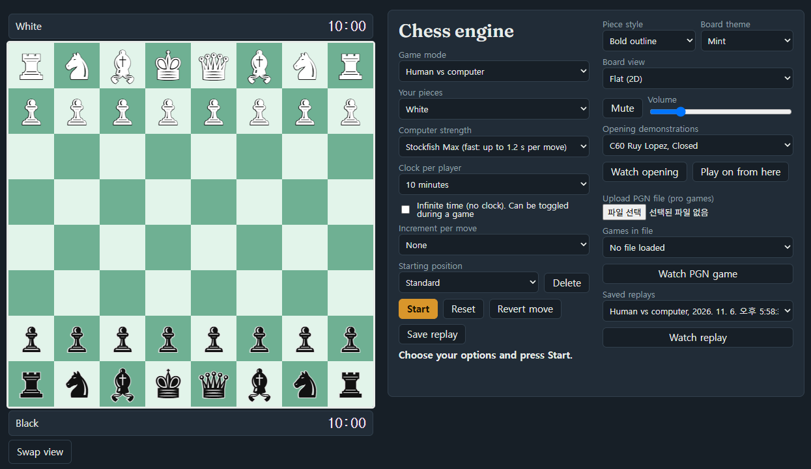

# Chess Engine

A browser-based chess application featuring a playable chessboard, multiple computer difficulty levels, Stockfish integration, game clocks, PGN import, opening demonstrations, and replay support.

## Features

- **Game modes:** human vs. human, human vs. computer, computer vs. computer, and board editor.
- **Chess rules:** legal move generation, check/checkmate and stalemate detection, castling, en passant, and pawn promotion.
- **Computer opponents:** built-in search engine with iterative deepening, alpha-beta/PVS search, quiescence search, move ordering, transposition tables, and an opening book.
- **Stockfish:** optional Stockfish.js integration for the highest strength settings, with a built-in engine fallback if Stockfish cannot load.
- **Difficulty settings:** Easy through Grandmaster, plus Stockfish strength presets.
- **Game controls:** clocks, increment, pause/stop controls, move takeback, move history, and board-side view swapping.
- **Analysis and learning:** opening demonstrations and PGN file import.
- **Replay:** save games locally and watch saved replays.
- **Customization:** board themes, piece styles, flat/3D board views, sound and volume controls.
- **Board editor:** create, name, save, load, and delete custom starting positions.
- **Responsive interface:** adapts to desktop and smaller screens; supports light/dark system appearance.



## Project structure

```text
chess-engine/
├── index.html   # Page structure and controls
├── styles.css   # Layout, board, themes, and visual styles
├── script.js    # Chess rules, engines, state, rendering, and interactions
└── README.md    # Project documentation
```

## Run locally

No build step or package installation is required.

1. Download or clone this repository.
2. Open `index.html` in a modern browser.
3. For the most reliable Stockfish/Web Worker behavior, serve the folder over HTTP rather than opening it as a `file://` URL. For example, with Python installed:

   ```bash
   python -m http.server 8000
   ```

4. Visit [http://localhost:8000](http://localhost:8000).

## Stockfish and network access

The Stockfish-powered difficulty presets load Stockfish.js from cdnjs at runtime. An internet connection is therefore needed for those presets. If the worker or Stockfish script cannot be loaded, the application falls back to its built-in engine. Lower difficulty presets use the built-in engine.

## Browser storage

Custom starting positions and saved replays are stored in the browser's `localStorage`. They remain available in the same browser profile until its site data is cleared. They are not automatically synchronized between devices.

## Controls

- Select a game mode and options, then choose **Start**.
- Move pieces by clicking a piece and destination square or by dragging and dropping.
- Use **Swap view** to rotate the board perspective without changing which player controls each color.
- Use **Revert move** to take back the most recent move.
- Use the editor mode to compose and save a custom starting position.

## Technical notes

- The project uses plain HTML, CSS, and JavaScript; no frontend framework is required.
- The chess engine and UI run in the browser. Stockfish is loaded in a Web Worker when a Stockfish preset is selected.
- The original implementation has been separated into three files without intentionally changing game behavior. The JavaScript has been whitespace-formatted for readability; the algorithms and feature logic are retained.

## License

No license is specified. Add a `LICENSE` file before distributing or accepting contributions if you want to grant others explicit reuse rights.
